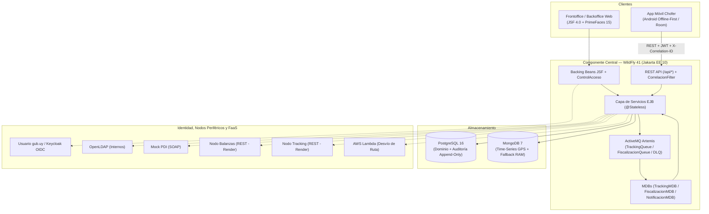

# Arquitectura del Sistema (`ARCHITECTURE.md`)

**carga.uy** — Plataforma de Gestión, Seguimiento y Fiscalización de Transporte de Carga (Grupo 07, TSE 2026).

---

## 1. Visión General y Estilo Arquitectónico

La solución sigue una **arquitectura empresarial en capas sobre Jakarta EE 10** empaquetada como EAR (`CargaUY.ear` = `CargaUY-ejb.jar` + `CargaUY-web.war`) y desplegada en **WildFly 41 (`standalone-full.xml`)**, combinada con:
- **Persistencia políglota:** PostgreSQL 16 (transaccional relacional + auditoría inmutable) y MongoDB 7 (colección Time-Series para posiciones GPS).
- **Mensajería asíncrona orientada a eventos:** Apache ActiveMQ Artemis embebido (Jakarta Messaging 3.1) con colas dedicadas y Dead-Letter Queues (DLQ).
- **Cómputo serverless (FaaS):** AWS Lambda para evaluación de desvíos de ruta respecto al corredor vial asignado.
- **Cliente móvil offline-first:** Aplicación Android (Kotlin + Room SQLite + `WorkManager`) con sincronización idempotente por lotes.

---

## 2. Módulos y Capas del Componente Central

### 2.1 Capa de Presentación (`web`)
- **Frontoffice y Backoffice JSF/PrimeFaces:** Vistas organizadas por rol (`/empresa/*`, `/funcionario/*`, `/autoridad/*`, `/admin/*` y vistas públicas de validación).
- **API REST (`AplicacionRest` bajo `/api/*`):** Endpoints para la aplicación móvil (`/api/chofer/eventos/sync`, `/api/chofer/guias`), integraciones de nodos y observabilidad (`/api/ops/health`, `/api/ops/metrics`).
- **Filtros transversales:** `CorrelacionFilter` propaga o genera `X-Correlation-ID` en cada petición HTTP y emite logs JSON estructurados; `AuthFilter` y `NacimientoPendienteFilter` resguardan rutas y completitud de perfil ciudadano.

### 2.2 Capa de Negocio, Seguridad y Persistencia (`ejb`)
- **Servicios `@Stateless` (`service/`):** Toda regla de negocio y verificación de autorización (`ControlAcceso`) se ejecuta en la capa EJB (no solo en la UI).
- **Entidades JPA (`domain/entity/`):** `Usuario`, `Empresa`, `VinculoEmpresa`, `Vehiculo`, `HabilitacionPNC`, `InspeccionTecnica`, `GuiaDeViaje`, `PesadaBalanza`, `EventoViaje`, `PuntoTracking`, `Infraccion`, `Descargo`, `RegistroAuditoria`, `CertificadoDigital`, `ParametroSistema`, `NodoPeriferico`.
- **Persistencia NoSQL (`nosql/PosicionNoSqlRepository`):** Almacena las posiciones GPS en la colección Time-Series `eventos_posicion` de MongoDB 7, con degradación elegante automática a un buffer circular acotado en memoria (hasta 2.000 puntos por guía) cuando MongoDB no responde.

---

## 3. Flujos Críticos Implementados

### 3.1 Ingesta Asíncrona de Tracking e Idempotencia (AC012)
1. El móvil genera un `uuid` único por evento en Room SQLite y envía lotes a `POST /api/chofer/eventos/sync`.
2. `SincronizacionServiceImpl` encola cada evento en `java:/jms/queue/TrackingQueue` vía `TrackingMessageProducer` (con `JMSCorrelationID` y `X_Correlation_ID`) liberando inmediatamente el hilo HTTP.
3. `TrackingMDB` consume la cola, verifica idempotencia estricta por `uuid` (`UNIQUE` en BD y consulta previa `existeEvento`), persiste la posición en MongoDB Time-Series y los hitos de ciclo de vida (`INICIO`, `CARGA`, `DESCARGA`, `INCIDENTE`, `FIN`) en PostgreSQL.
4. Las consultas de ruta ordenan explícitamente por el timestamp de origen del GPS (`tiempo ASC`), reconstruyendo trayectorias aunque los paquetes lleguen fuera de orden (*out-of-order*).

### 3.2 Fiscalización Automática, Ciclo de Vida y Cierre por Vencimiento
1. `FiscalizacionMessageProducer` / `FiscalizacionMDB` y `MotorFiscalizacion` evalúan de forma asíncrona 4 infracciones:
   - `EXCESO_DE_CARGA` (pesaje en balanza > tara + capacidad declarada + tolerancia configurable).
   - `SIN_HABILITACION` (PNC o ITV vencidos a la fecha del viaje).
   - `VIAJE_SIN_GUIA` (actividad registrada sin guía `EN_CURSO`).
   - `DESVIO_DE_RUTA` (evaluación geométrica vía FaaS / fallback local contra tolerancia configurable).
2. **Máquina de estados controlada (`EstadoInfraccion`):**
   `DETECTADA` $\rightarrow$ `NOTIFICADA` $\rightarrow$ `EN_DESCARGO` $\rightarrow$ `CONFIRMADA` | `DESESTIMADA`.
3. **Cierre automático tras 7 días:** Un timer `@Schedule` horario (`GestionInfraccionesServiceImpl.ejecutarCierreAutomaticoSinDescargo`) confirma automáticamente (`CONFIRMADA`) toda infracción en estado `NOTIFICADA` sin descargo tras cumplirse 7 días desde `fechaNotificacion`, registrando el evento en la auditoría.
4. **Auditoría inmutable (*append-only*):** `AuditoriaTriggerInstaller` (`@Startup`) instala en PostgreSQL el trigger `trg_audit_immutable` sobre `registro_auditoria`, bloqueando cualquier `UPDATE` o `DELETE` a nivel de motor de base de datos.

### 3.3 Firma Digital de Actas (PKCS#12)
- Las autoridades cargan su certificado digital `.p12`/`.pfx` personal en `/funcionario/certificados.xhtml`.
- Desde `bandeja-fiscalizacion.xhtml`, los funcionarios/autoridades emiten y firman digitalmente actas PDF de infracción garantizando integridad y no repudio.

### 3.4 Autenticación, Identidad y Privacidad (Ley 18.331)
- **Ciudadanos y Funcionarios:** OIDC/PKCE con **Usuario gub.uy** (`auth-testing.iduruguay.gub.uy` o perfil `mock-gub` con Keycloak), enriqueciendo datos y validando mayoría de edad contra **PDI (SOAP)**.
- **Autoridades y Administradores:** Autenticación interna contra **OpenLDAP** con contraseñas protegidas mediante hash con salt.
- **Privacidad pública:** Los listados y reportes agregados públicos aplican un umbral mínimo de agregación para impedir la reidentificación de empresas, vehículos o choferes individuales.

---

## 4. Resiliencia, Integraciones y Observabilidad

- **Integraciones con tolerancia a fallos (`BalanzaClient`, `TrackingClient`, `ClientePdi`, `FaasTrackingClient`):**
  - Timeouts explícitos configurables (`BALANZA_TIMEOUT_SECONDS`, `TRACKING_TIMEOUT_SECONDS`).
  - Política de reintentos acotada ante fallos transitorios.
  - **Circuit Breaker** y **Bulkhead** por cliente externo para evitar agotamiento de hilos ante caída de un nodo periférico.
- **Trazabilidad y Observabilidad:**
  - `X-Correlation-ID` propagado desde HTTP hacia JMS (`JMSCorrelationID`) y hacia las llamadas salientes SOAP/REST.
  - Logs JSON estructurados por componente.
  - Métricas de negocio e infraestructura expuestas en `/api/ops/metrics` y verificación de estado en `/api/ops/health`.
