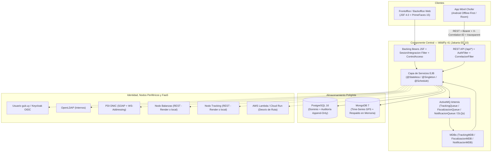
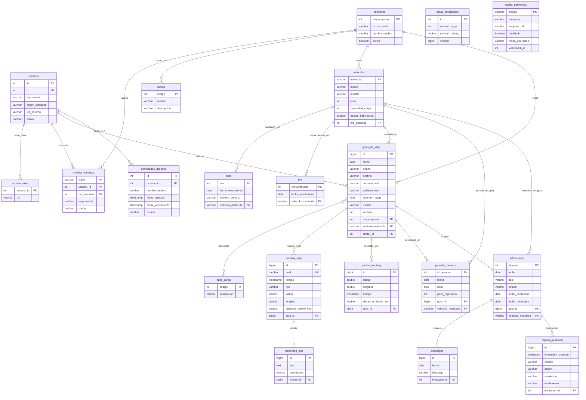
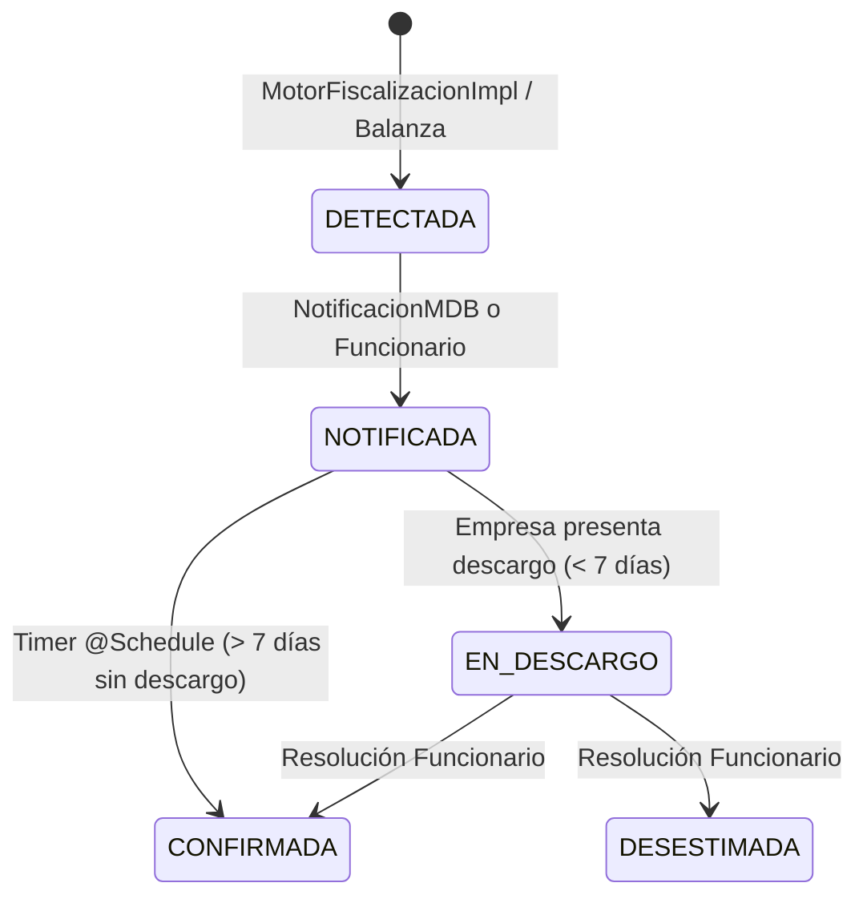

# Arquitectura del Sistema (`ARCHITECTURE.md`)

**carga.uy** — Plataforma de Gestión, Seguimiento y Fiscalización de Transporte de Carga (Grupo 07, TSE 2026).

---

## 1. Visión General y Estilo Arquitectónico

La solución implementa una **arquitectura empresarial en capas sobre Jakarta EE 10**, empaquetada como EAR (`CargaUY.ear` = `CargaUY-ejb.jar` + `CargaUY-web.war`) junto a un WAR auxiliar de callback OIDC en raíz (`gub-callback-root.war`) y desplegada en **WildFly 41 (`standalone-full.xml`, Java 21 con bytecode Java 17)**, combinada con:

- **Persistencia políglota:** PostgreSQL 16 (modelo transaccional relacional + pista de auditoría inmutable *append-only*) y MongoDB 7 (colección Time-Series para serie temporal GPS).
- **Mensajería asíncrona orientada a eventos:** Apache ActiveMQ Artemis embebido en WildFly (Jakarta Messaging 3.1) con colas dedicadas (`TrackingQueue`, `FiscalizacionQueue`, `NotificacionQueue`) y *Dead-Letter Queues* individuales (`DLQ.*`).
- **Cómputo serverless (FaaS):** Función en Python (`faas/tracking-desvio-lambda`) compatible con AWS Lambda / Google Cloud Run Functions para cálculo geoespacial de desvío de ruta sobre corredores de la Red Vial Nacional (MTOP), con respaldo geométrico local.
- **Cliente móvil offline-first:** Aplicación Android nativa (`CargaUYAndroid`, Kotlin + Room SQLite + `WorkManager`) con sincronización por lotes e idempotencia por UUID.

---

## 2. Módulos y Capas del Componente Central

### 2.1 Capa de Presentación (`web` + `gub-callback-root`)
- **Frontoffice y Backoffice JSF/PrimeFaces:** Vistas organizadas por rol bajo `/portal/*`, `/empresa/*`, `/funcionario/*`, `/backoffice/*` y `/admin/*`, con plantilla unificada (`WEB-INF/templates/template.xhtml`) y exportación de reportes agregados (`ReporteDashboardExporter`, PDF/Excel/CSV).
- **API REST (`AplicacionRest` bajo `/api/*`):**
  - `ChoferResource` (`/api/chofer/eventos/sync`, `/api/chofer/eventos/faas`, `/api/chofer/eventos/{guiaId}`, `/api/chofer/guia-asignada`, `/api/chofer/guias`, `/api/chofer/incidente`).
  - `BalanzaResource` (`/api/balanza/pesaje`, `/api/balanza/mock-sync`, `/api/balanza/guia/{guiaId}`).
  - `ApiP1` (`/api/auth/*`, `/api/empresas`, `/api/public/ready`, `/api/public/health`) y `CiudadanosApi` (`/api/ciudadanos/{ci}/pdi`).
  - `OperacionesApi` (`/api/ops/health`, `/api/ops/metrics` — solo administrador, con estado `UP` / `DEGRADED` / `DOWN`).
- **Filtros transversales y seguridad web:**
  - `CorrelacionFilter` (`@WebFilter("/*")`): normaliza o genera `X-Correlation-ID` y W3C `traceparent` vía `TraceContext`, los devuelve en headers HTTP y registra logs JSON estructurados de cada petición con duración y códigos de estado.
  - `CharacterEncodingFilter` y `NacimientoPendienteFilter` (fuerzan UTF-8 y completitud de fecha de nacimiento tras login federado).
  - `IntegracionSesionFilter` (rutas `*.xhtml` y `/detalle-viaje`, validando rol, transporte seguro y CSP) y `SesionFilter` (`/app/*`, validación CSRF).
  - `AuthFilter` (`@Provider` JAX-RS): valida tokens Bearer (`AutenticacionService`), secreto compartido `X-FaaS-Secret` (comparación en tiempo constante + límite de payload 1 MB) y propiedad de guía/chofer (`ControlAcceso`).

### 2.2 Capa de Negocio, Seguridad y Persistencia (`ejb`)
- **Servicios `@Stateless` y Motor de Reglas (`service/`, `fiscalizacion/`):** Toda regla de negocio y autorización por rol/vínculo empresarial (`ControlAcceso`) se valida en la capa EJB (independiente de la UI). El cálculo de fiscalización reside en `MotorFiscalizacionImpl` y la parametrización en caliente en `EvaluadorToleranciasService` / `ReglaFiscalizacion`.
- **Entidades JPA (`domain/entity/`):**
  - **Identidad y acceso:** `Usuario` (herencia `JOINED` → `Ciudadano`, `Chofer`, `Funcionario`, `Autoridad`, `Administrador`), `SesionAcceso`, `FlujoIdentidad`, `CertificadoDigital`.
  - **Empresas y flota:** `Empresa`, `VinculoEmpresa`, `Rubro`, `TipoCarga`, `Vehiculo`, `PNC`, `ITV`.
  - **Viajes, eventos y pesajes:** `GuiaDeViaje`, `EventoViaje`, `IncidenteRuta`, `PuntoTracking`, `PesadaBalanza`.
  - **Fiscalización, auditoría y configuración:** `Infraccion`, `Descargo`, `RegistroAuditoria`, `ReglaFiscalizacion`, `ConfiguracionNodoPeriferico`.
- **Persistencia NoSQL (`nosql/PosicionNoSqlRepository`):** Almacena las posiciones GPS (`TipoEvento.POSICION`) en la colección Time-Series nativa `cargauy_tracking.eventos_posicion` de MongoDB 7 (`timeField="tiempo"`, `metaField="metadata"`, `granularity=SECONDS`), con índices compuestos por `(metadata.guiaId, tiempo)`, `(metadata.guiaId, distanciaDesvioKm)` y `uuid`, además de un respaldo automático en memoria (`ConcurrentHashMap`) cuando MongoDB no responde temporalmente.

---

## 3. Modelo de Datos Políglota (PostgreSQL 16 + MongoDB 7)

### 3.1 Modelo Relacional (PostgreSQL 16)

El esquema relacional concentra el maestro de empresas, flota y usuarios, la planificación de guías (unificando guía y ciclo de vida de viaje en `guias_de_viaje`), los hitos operativos y el expediente legal de fiscalización y auditoría.

### 3.2 Garantías de Integridad en Base de Datos
- **Auditoría inmutable (*append-only*) a nivel de motor:** Además del script `docker/postgres/init/02-audit-immutable.sql`, el bean `@Startup` `AuditoriaTriggerInstaller` (dependiente de `EsquemaMigracionStartupBean`) instala de forma idempotente en cada despliegue los triggers PostgreSQL `trg_audit_immutable` (`BEFORE UPDATE OR DELETE`) y `trg_audit_no_truncate` (`BEFORE TRUNCATE`) sobre `registro_auditoria`.
- **Detección de vehículos sin guía e idempotencia:** Tanto `pesadas_balanza` como `infracciones` admiten `guia_id` nulo y referencian `vehiculo_matricula`. `EsquemaMigracionStartupBean` crea el índice único parcial `uk_infraccion_vehiculo_sin_guia_fecha ON infracciones (vehiculo_matricula, fecha, tipo) WHERE guia_id IS NULL AND vehiculo_matricula IS NOT NULL` para evitar infracciones duplicadas ante lecturas repetidas en balanza.
- **Bloqueo optimista (`@Version`):** Presente en `GuiaDeViaje`, `Empresa`, `Usuario`, `VinculoEmpresa` y `ReglaFiscalizacion` para evitar condiciones de carrera en sincronización móvil y edición concurrente.

### 3.3 Serie Temporal NoSQL (MongoDB 7)
- Base de datos `cargauy_tracking`, colección Time-Series `eventos_posicion`:
  - `timeField`: `tiempo` (timestamp de origen generado en el móvil/nodo), `metaField`: `metadata` (`guiaId`, `matricula`, `tipo`), `granularity`: `SECONDS`.
  - Campos geoespaciales y de carga: `uuid`, `ubicacion` (`GeoJSON Point [longitud, latitud]`), `distanciaDesvioKm`, `cantidadKg`, `mercaderia`, `empresaCarga`, `incidente`.
  - Si `MongoDB` no está accesible, `PosicionNoSqlRepository` conserva los eventos en `respaldoMemoria` (`ConcurrentHashMap`) y mantiene la continuidad operativa del portal y del motor de fiscalización.

---

## 4. Flujos Críticos Implementados

### 4.1 Ingesta Asíncrona de Tracking, FaaS e Idempotencia (AC012)
1. La app móvil genera un `uuid` único por evento en Room SQLite y envía lotes a `POST /api/chofer/eventos/sync`.
2. `ChoferResource` valida precondiciones (`GestionEventosServiceLocal.validarEventoPreEncolado`) y deduplicación inmediata (`existeEvento`); los eventos de posición pura se publican vía `TrackingMessageProducer` en `java:/jms/queue/TrackingQueue` (con `JMSCorrelationID`, `X_Correlation_ID` y `traceparent`), liberando el hilo HTTP sin esperar la persistencia ni la fiscalización. Los hitos interactivos del chofer (`INICIO`, `FIN`, `CARGA_PARCIAL`, `DESCARGA_PARCIAL`, `INCIDENTE`) también pueden procesarse síncronamente para devolver confirmación inmediata al usuario.
3. Si el evento proviene de la invocación directa desde la función FaaS (`POST /api/chofer/eventos/faas`), `AuthFilter` exige el header `X-FaaS-Secret` validado en tiempo constante (`MessageDigest.isEqual`) y limita el cuerpo a 1 MB.
4. `TrackingMDB` (`maxSession = 10`) consume `TrackingQueue`, verifica idempotencia por `uuid` (`UNIQUE` en `eventos_viaje` y búsqueda previa en MongoDB), calcula desvío de ruta con `FaasTrackingClient` (o usa `distanciaDesvioKm` precalculado), persiste posiciones en MongoDB Time-Series (`PosicionNoSqlRepository`) y hitos operativos en PostgreSQL, y dispara `FiscalizacionMessageProducer` hacia `FiscalizacionQueue`.
5. ActiveMQ Artemis configura en `standalone-full.xml` políticas `address-full-policy = PAGE` (10 MB por dirección), `max-delivery-attempts = 5` (`redelivery-delay = 2000` ms) y *Dead-Letter Queues* específicas (`DLQ.TrackingQueue`, `DLQ.FiscalizacionQueue`, `DLQ.NotificacionQueue`).
6. Las consultas de trayectoria ordenan cronológicamente por la marca de origen del GPS (`tiempo ASC`), reconstruyendo recorridos coherentes incluso cuando los lotes llegan desordenados (*out-of-order*).

### 4.2 Fiscalización Automática, Máquina de Estados y Cierre a 7 Días
1. `FiscalizacionMDB` (`maxSession = 5`) y `MotorFiscalizacionImpl` evalúan las 4 reglas tipificadas en `TipoInfraccion`:
   - `EXCESO_DE_CARGA`: pesada registrada en balanza superior a tara (`vehiculo.peso`) + capacidad de carga (`vehiculo.capacidadCarga`) + tolerancia configurable (`ReglaFiscalizacion.umbralCarga`).
   - `SIN_HABILITACION`: `PNC` o `ITV` inexistentes o vencidos a la fecha del viaje.
   - `VIAJE_SIN_GUIA`: pesaje o actividad de tracking detectada sobre un vehículo sin guía `EN_CURSO`.
   - `DESVIO_DE_RUTA`: distancia mínima a la polilínea MTOP (`RedVialUruguay` / `FaasTrackingClient`) mayor al umbral en km (`ReglaFiscalizacion.umbralTracking`).
2. **Máquina de estados controlada (`EstadoInfraccion`):**

3. **Cierre automático tras 7 días:** Un EJB Timer horario `@Schedule(hour = "*", minute = "0", persistent = false)` en `GestionInfraccionesServiceImpl.ejecutarCierreAutomaticoSinDescargo` bloquea pesimistamente las infracciones `NOTIFICADA` sin descargo cuyo plazo de `PLAZO_DESCARGO_DIAS` (7 días desde `fecha_notificacion`) haya vencido, transiciona su estado a `CONFIRMADA` y guarda la traza en `registro_auditoria`.

### 4.3 Firma Digital de Actas (PKCS#12)
- Las autoridades y operadores autorizados cargan su certificado `.p12`/`.pfx` en `/funcionario/certificados.xhtml` (`CertificadoDigitalEJB`, validando vigencia y revocación en `CertificadoDigital`).
- Desde `/funcionario/bandeja-fiscalizacion.xhtml`, `ActaServiceEJB` genera el acta oficial en PDF con **Apache PDFBox** e incrusta la firma criptográfica CMS/PKCS#7 mediante **BouncyCastle** (`bcprov-jdk18on`, `bcpkix-jdk18on`), garantizando integridad y no repudio.

### 4.4 Autenticación, Identidad y Privacidad (Ley N.º 18.331)
- **Ciudadanos, Choferes y Funcionarios:** Autenticación federada OIDC (con soporte PKCE en `FlujoIdentidad`) contra **Usuario gub.uy** (o Keycloak local con perfil `mock-gub`), enriqueciendo identidad y validando mayoría de edad contra **PDI / DNIC (SOAP)** mediante `ClientePdi`.
- **Autoridades y Administradores:** Autenticación interna contra **OpenLDAP** (`LdapClient`) con contraseñas codificadas en `{SSHA}` (salt aleatorio de 8 bytes, RFC 2307) y validación BCrypt (`at.favre.lib:bcrypt`) para credenciales locales.
- **Privacidad pública (k-anonimato):** Tanto `DashboardServiceImpl.obtenerResumenPublico()` como `PortalPublicoBean` aplican un umbral mínimo estricto de **`k = 3`** (`UMBRAL_MINIMO_AGREGACION_K = 3`), suprimiendo u ocultando agrupaciones con menos de 3 registros para impedir la reidentificación indirecta de empresas, vehículos o choferes.

---

## 5. Resiliencia, Integraciones y Observabilidad

- **Clientes resilientes con degradación controlada:**
  - `BalanzaClient`: Bulkhead (`Semaphore(8)`), Circuit Breaker (apertura tras 3 fallos consecutivos durante 10 s con estado *Half-Open*), hasta 2 intentos por consulta GET, timeout configurable (`BALANZA_TIMEOUT_SECONDS`, por defecto 15 s; 5 s en `/health`) y soporte de múltiples estaciones configuradas en `nodos_perifericos`.
  - `TrackingClient`: Bulkhead (`Semaphore(8)`), Circuit Breaker, conmutación entre URLs candidatas, timeout configurable (`TRACKING_TIMEOUT_SECONDS`, por defecto 15 s; 5 s en `/health`) y control remoto de nodos de tracking.
  - `ClientePdi`: Bulkhead (`Semaphore(4)`), Circuit Breaker, 2 reintentos SOAP con WS-Addressing, timeouts acotados (1 s conexión / 2 s respuesta) y validación obligatoria de HTTPS fuera del entorno local.
  - `FaasTrackingClient`: Timeout HTTP de 6 s y fallback automático y determinista al motor geométrico local `RedVialUruguay` (grafo Dijkstra sobre Rutas Nacionales de Uruguay).
- **Trazabilidad distribuida y observabilidad:**
  - `TraceContext` propaga `X-Correlation-ID` y W3C `traceparent` (`00-<traceId>-<spanId>-01`) desde HTTP (`CorrelacionFilter`) hacia JMS (`TrackingMessageProducer`, `FiscalizacionMessageProducer`, `NotificacionMessageProducer` y sus MDBs), SOAP (`ClientePdi`) y REST saliente (`BalanzaClient`, `TrackingClient`, `FaasTrackingClient`).
  - Logs JSON estructurados por componente.
  - Endpoints de monitoreo: públicos (`/api/public/ready`, `/api/public/health`) y administrativos protegidos (`/api/ops/health`, `/api/ops/metrics`).

---

## 6. Requerimientos Opcionales Implementados (4 puntos)

| Requerimiento Opcional | Puntaje | Implementación en el Repositorio |
| :--- | :---: | :--- |
| **Base de datos NoSQL / Serie Temporal** | 1 pto | MongoDB 7 Time-Series (`cargauy_tracking.eventos_posicion`) en `PosicionNoSqlRepository` + respaldo resiliente en memoria |
| **Cómputo Serverless / FaaS (Desvío de ruta)** | 1 pto | `faas/tracking-desvio-lambda/lambda_function.py` + `FaasTrackingClient` + polilíneas reales MTOP en `RedVialUruguay` |
| **Autenticación interna con LDAP** | 1 pto | Contenedor `openldap` (`docker/ldap`) + `LdapClient` (JNDI + `{SSHA}` con salt + validación LDAPS en producción) |
| **Firma Digital de Actas PDF (PKCS#12)** | 1 pto | Carga y ciclo de vida en `CertificadoDigitalEJB` + firma criptográfica PDFBox/BouncyCastle en `ActaServiceEJB` |
