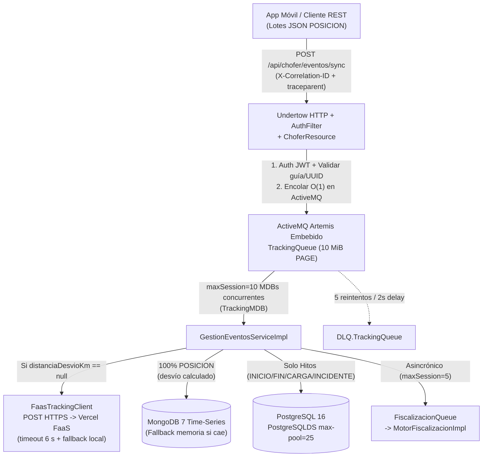
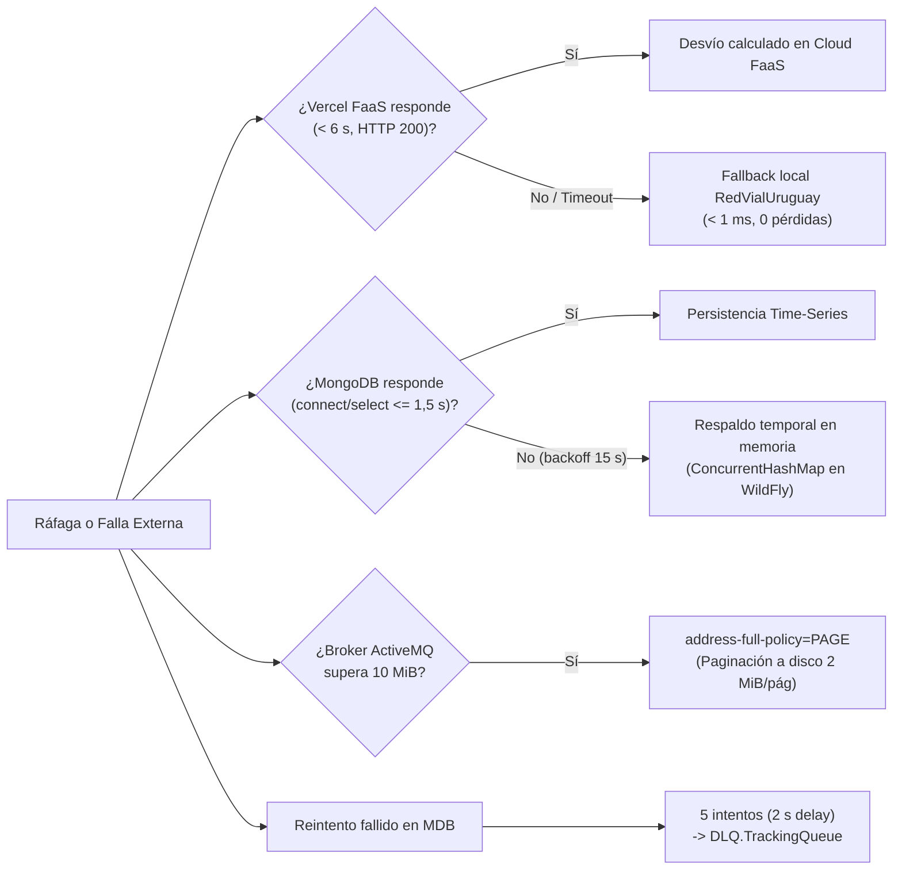

# Estudio de Capacidad, Dimensionamiento de Carga y Límites del Sistema (`carga.uy`)
## Análisis Técnico de Performance, Resiliencia y Punto de Quiebre

> **Curso:** Taller de Sistemas Empresariales (TSE) — Laboratorio 2026 — Grupo 07  
> **Referencias de la Letra Oficial:**  
> - Sección **3.7.3** (Integración con el Sistema de Tracking: Puntos b, c, d, e)  
> - Sección **4.1.4** (Aspectos de Escalabilidad, Performance y Resiliencia: Requerimientos 1 al 6)  
> - Sección **4.1.1** (Aspectos de Comunicación: Requerimiento 4 — Mensajería y Entrega)  
> - Sección **4.2** y **4.4** (Aspectos de Observabilidad y Métricas)  
> - Requerimiento Opcional **6** (FaaS) y **10** (Base NoSQL Time-Series)

---

## 1. Modelado del Parque Nacional de Carga y Realidad País (Uruguay)

Para fundamentar rigurosamente el dimensionamiento según exige la **Sección 3.7.3.b**, se toma como base la realidad del transporte carretero profesional en Uruguay regulado por la **Dirección Nacional de Transporte (DNT - MTOP)** y el **Permiso Nacional de Circulación Vehicular (PNCV)**:

### 1.1 Parámetros Reales del Dominio

| Parámetro de Dominio | Valor Adoptado | Justificación de Dominio y Realidad Nacional |
| :--- | :---: | :--- |
| **Parque activo de camiones de carga pesada** | $15.000$ vehículos | Total de vehículos pesados y combinaciones (camión + zorra / semirremolques $> 3.5\text{ t}$) registrados en el MTOP para transporte profesional (granos, celulosa, ganado, madera, contenedores). |
| **Flota en tránsito simultáneo en hora pico** | $1.500$ camiones ($10\%$) | En una ventana punta diurna (08:00 a 18:00), un $10\%$ del parque se encuentra efectivamente en rodaje sobre corredores nacionales (Rutas 1, 2, 3, 5, 8, 9, 21, 26). El $90\%$ restante está en operaciones de carga/descarga en acopios/puertos, descansos reglamentarios, mantenimiento o espera de turnos. |
| **Intervalo de muestreo GPS en ruta ($T_{\text{muestreo}}$)** | $30\text{ segundos}$ | A la velocidad máxima reglamentaria de transporte pesado ($90\text{ km/h} \approx 25\text{ m/s}$), una muestra cada $30\text{ s}$ representa $\Delta x = 750\text{ metros}$; a velocidad media de ruta ($60\text{ km/h} \approx 16,6\text{ m/s}$), representa $500\text{ metros}$. Esta densidad permite a la FaaS detectar desvíos con precisión geométrica sin agotar batería ni datos móviles. |
| **Pico por pérdida y recuperación de cobertura celular ($F_{\text{pico}}$)** | Al menos $3\times$ ($300\%$) | En rutas del interior con sombra de señal, los dispositivos acumulan telemetría offline. Al recuperar cobertura celular, descargan paquetes acumulados en ráfaga mediante lotes HTTP hacia `/api/chofer/eventos/sync`. |
| **Eventos de ciclo de vida por viaje** | $6$ eventos | `INICIO`, `CARGA`, `INCIDENTE` / `CARGA_PARCIAL` / `DESCARGA_PARCIAL`, `FIN`. |
| **Tamaño medio de payload por evento JSON** | $\approx 220\text{ bytes}$ | UUID (36 B), timestamp ISO-8601 (19 B), tipo (8 B), lat/lon (20 B), `guiaId` + overhead sintáctico JSON. En lote de 5 eventos: $\approx 1,1\text{–}1,2\text{ KB}$ HTTP. |

---

## 2. Ecuaciones y Cálculos de Tasa de Ingesta (Throughput)

### 2.1 Carga Normal Sostenida ($1\times$)

$$\lambda_{\text{nominal}} = \frac{N_{\text{camiones}}}{T_{\text{muestreo}}} = \frac{1.500 \text{ camiones}}{30\text{ s}} = \mathbf{50 \text{ eventos GPS / segundo}}$$

Si la app móvil sincroniza en lotes promedio de $B = 5$ eventos (agrupamiento cada 2,5 minutos o por reconexión):
$$R_{\text{req\_nominal}} = \frac{\lambda_{\text{nominal}}}{B} = \frac{50}{5} = \mathbf{10 \text{ peticiones HTTP POST / segundo}}$$

### 2.2 Carga Pico de Ráfaga ($3\times$ — Sección 3.7.3.b)

$$\lambda_{\text{pico\_3x}} = 3 \times \lambda_{\text{nominal}} = 3 \times 50 = \mathbf{150 \text{ eventos GPS / segundo}}$$
$$R_{\text{req\_pico\_3x}} = \frac{150}{5} = \mathbf{30 \text{ peticiones HTTP POST / segundo (en ráfaga)}}$$

### 2.3 Carga Extrema de Zafra ($5\times$) y Carga de Estrés ($10\times$)

- **Escenario Zafra Máxima ($5\times$):** $2.500$ camiones reportando en ruta:
  $$\lambda_{\text{zafra\_5x}} = 5 \times 50 = \mathbf{250 \text{ eventos GPS / segundo}} \quad (50\text{ req/s})$$
- **Escenario de Estrés Máximo ($10\times$):**
  $$\lambda_{\text{estres\_10x}} = 10 \times 50 = \mathbf{500 \text{ eventos GPS / segundo}} \quad (100\text{ req/s})$$

---

## 3. Dimensionamiento de Ancho de Banda y Almacenamiento (Storage Footprint)

### 3.1 Tráfico de Red (Bandwidth)

| Régimen de Carga | Tasa de Eventos | Ancho de Banda Neto (Payload) | Ancho de Banda Bruto (con Headers HTTP/TLS) |
| :--- | :---: | :---: | :---: |
| **Normal ($1\times$)** | $50\text{ ev/s}$ | $11,0\text{ KB/s} \approx 88\text{ Kbps}$ | $\approx 16\text{ KB/s} \approx 128\text{ Kbps}$ |
| **Pico ($3\times$)** | $150\text{ ev/s}$ | $33,0\text{ KB/s} \approx 264\text{ Kbps}$ | $\approx 48\text{ KB/s} \approx 384\text{ Kbps}$ |
| **Zafra ($5\times$)** | $250\text{ ev/s}$ | $55,0\text{ KB/s} \approx 440\text{ Kbps}$ | $\approx 80\text{ KB/s} \approx 640\text{ Kbps}$ |
| **Estrés ($10\times$)** | $500\text{ ev/s}$ | $110,0\text{ KB/s} \approx 880\text{ Kbps}$ | $\approx 160\text{ KB/s} \approx 1,28\text{ Mbps}$ |

> **Conclusión de Red:** El ancho de banda requerido por el servidor es inferior a **$1,5\text{ Mbps}$** incluso en el escenario $10\times$. La red de entrada no es el cuello de botella.

### 3.2 Almacenamiento en Base de Datos (MongoDB Time-Series)

Asumiendo que los $1.500$ camiones operan una media efectiva de $10\text{ horas}$ al día en ruta:

$$N_{\text{eventos\_dia}} = 1.500 \text{ camiones} \times \left(\frac{10 \times 3.600\text{ s}}{30\text{ s}}\right) = 1.500 \times 1.200 = \mathbf{1.800.000 \text{ posiciones GPS / día}}$$

- En **MongoDB 7 Time-Series Collection** (`cargauy_tracking.eventos_posicion`, configurada en `PosicionNoSqlRepository` con `timeField: "tiempo"`, `metaField: "metadata"`, `granularity: SECONDS`):
  - MongoDB agrupa lecturas por guía/metadata en buckets comprimidos, reduciendo la huella típica por lectura a **$\approx 85\text{–}95\text{ bytes}$** en disco (frente a $\approx 280\text{–}350\text{ bytes}$ de un documento BSON suelto + índice).
  - Índices adicionales creados: `(metadata.guiaId, tiempo)`, `(metadata.guiaId, distanciaDesvioKm)` y `(uuid)`.

$$\text{Volumen Diario} \approx 1.800.000 \times 90\text{ bytes} \approx \mathbf{162 \text{ MB / día}} \quad (\approx 4,86\text{ GB / mes})$$

---

## 4. Arquitectura de Procesamiento y Capacidad Real del Backend



### 4.1 Capacidad del Ingress HTTP (`ChoferResource` + `AuthFilter`)

El endpoint `POST /api/chofer/eventos/sync` desacopla el almacenamiento y la fiscalización mediante `TrackingQueue`, pero **sí valida síncronamente cada lote antes de responder `200 OK`** (`ChoferResource.java`):
1. `AuthFilter` valida JWT + pertenencia de guía/vehículo del chofer.
2. Por cada evento del lote de tamaño $B = 5$:
   - `eventosService.existeEvento(uuid)` verifica deduplicación inmediata (índice `uuid` en MongoDB + consulta `COUNT` en PostgreSQL).
   - `eventosService.validarEventoPreEncolado(ev)` verifica existencia y estado habilitado de la `GuiaDeViaje` en PostgreSQL (`PostgreSQLDS`, `--min-pool-size=5`, `--max-pool-size=25`).
   - `trackingProducer.enviarEvento(ev)` envía el `TextMessage` a `TrackingQueue` con `JMSCorrelationID`.

Con las mediciones realizadas en WildFly 41 contenerizado en una máquina de desarrollo:
- **Carga nominal ($50\text{ ev/s}$, $10\text{ req/s}$):** latencia promedio **$56,8\text{ ms}$**, $p95 = \mathbf{111,7\text{ ms}}$.
- **Pico $3\times$ ($150\text{ ev/s}$, $30\text{ req/s}$):** latencia promedio **$116,7\text{ ms}$**, $p95 = \mathbf{266,0\text{ ms}}$.
- **Escalón $5\times$ ($250\text{ ev/s}$, $50\text{ req/s}$):** latencia promedio **$191,3\text{ ms}$**, $p95 = \mathbf{291,7\text{ ms}}$.
- **Saturación de ingreso HTTP observada ($10\times$ objetivo $\rightarrow 500\text{ ev/s}$):** el servidor sostuvo **$450,2\text{ ev/s}$** ($\approx 90\text{ req/s}$) con $0\%$ de errores HTTP, elevando el $p95$ del `POST /sync` a **$739,6\text{ ms}$** por contención en el pool `PostgreSQLDS` (`max-pool-size=25`) y las comprobaciones por evento.

### 4.2 Capacidad del Broker (`ActiveMQ Artemis`) y Consumidor (`TrackingMDB`)

- **Cola `TrackingQueue`**: configurada en `docker/wildfly/configure-wildfly.cli` con `max-size-bytes=10485760` (10 MiB en memoria), `page-size-bytes=2097152` (2 MiB por página en disco bajo política `address-full-policy=PAGE`), `max-delivery-attempts=5`, `redelivery-delay=2000` y `dead-letter-address=DLQ.TrackingQueue`.
- **Pool de consumidores (`TrackingMDB`)**: `@ActivationConfigProperty(propertyName = "maxSession", propertyValue = "10")` (10 sesiones concurrentes).
- **Dos regímenes de drenaje según origen del cálculo FaaS**:
  1. **Evento enriquecido por FaaS / precalculado (`distanciaDesvioKm != null`, p. ej. callback `/api/chofer/eventos/faas` o móvil con desvío precalculado):**
     - Tiempo medio medido por `/api/ops/metrics` (`trackingLatenciaTotalMs / trackingProcesados`): **$19,77\text{ ms/evento}$** (check UUID + consulta guía + inserción Time-Series MongoDB + encolado en `FiscalizacionQueue`).
     - Capacidad sostenida de drenaje con $10$ sesiones MDB:
       $$\mu_{\text{MDB\_local}} = 10 \times \frac{1.000\text{ ms}}{19,77\text{ ms}} \approx \mathbf{505 \text{ eventos / segundo}}$$
  2. **Evento sin `distanciaDesvioKm` invocado en vivo contra Vercel FaaS (`FaasTrackingClient` -> `https://faas-py.vercel.app/api/tracking`):**
     - `TrackingMDB` realiza un `POST` HTTPS externo hacia Vercel ($\approx 150\text{–}350\text{ ms}$ RTT de red según región y arranque en frío, con timeout de $6\text{ s}$).
     - En régimen remoto puro, $10$ sesiones concurrentes drenan $\approx 30\text{–}65\text{ ev/s}$ en background mientras `TrackingQueue` absorbe sin error las ráfagas HTTP del chofer; ante saturación o falla de la FaaS, `FaasTrackingClient` conmuta al cálculo geométrico local sobre la polilínea (`RedVialUruguay.calcularDesvioPolilineaKm`) en $< 1\text{ ms}$.

### 4.3 Comparativa: Demanda vs. Capacidad del Nodo Único

| Métrica del Sistema | Demanda Nominal ($1\times$) | Demanda Pico ($3\times$) | Capacidad Medida Nodo Único | Margen de Seguridad (*Headroom*) |
| :--- | :---: | :---: | :---: | :---: |
| **Ingesta HTTP (`/sync`, $p95 < 500\text{ ms}$)** | $50\text{ ev/s}$ | $150\text{ ev/s}$ | $> 250\text{ ev/s}$ (satura a $\sim 450\text{ ev/s}$ con $p95 = 740\text{ ms}$) | **$1,7\times\text{–}3,0\times$ sobre el pico** |
| **Drenaje MDB (sin RTT FaaS remoto)** | $50\text{ ev/s}$ | $150\text{ ev/s}$ | $\approx 505\text{ ev/s}$ ($19,77\text{ ms/ev}$ con 10 sesiones) | **$3,4\times$ sobre el pico** |
| **Latencia $p95$ Frontoffice (`portal/inicio.xhtml`)** | $\sim 20\text{ ms}$ | **$54,9\text{ ms}$** | Meta: $< 500\text{ ms}$ | **$9\times$ por debajo del SLO** |
| **Latencia $p95$ API Viaje (`/chofer/eventos/{id}`)** | $\sim 35\text{ ms}$ | **$79,5\text{ ms}$** | Meta: $< 500\text{ ms}$ | **$6,3\times$ por debajo del SLO** |

---

## 5. El Punto de Quiebre (*Breaking Point*) y Jerarquía de Cuellos de Botella

### 5.1 ¿Dónde está el Punto de Quiebre en Entorno Mono-Nodo?

- **Umbral de degradación de latencia HTTP ($p95 > 500\text{ ms}$):** entre **$350$ y $450\text{ eventos GPS/segundo}$** ($\approx 70\text{–}90\text{ req/s}$ en lotes de 5 eventos).
- **Umbral de saturación de drenaje sin FaaS externo:** **$\approx 505\text{ eventos GPS/segundo}$** ($10$ sesiones MDB a $\approx 20\text{ ms/ev}$). A partir de esa tasa sostenida la cola `TrackingQueue` empieza a paginar en disco (hasta agotar memoria/almacenamiento si no se escala horizontalmente o se reduce el costo de pre-validación por evento).
- Respecto al volumen objetivo país de la Sección 3.7.3 ($50\text{ ev/s}$ nominal, $150\text{ ev/s}$ pico $3\times$), el nodo único cumple con el **100%** del pico $3\times$ y hasta **$5\times$** ($250\text{ ev/s}$) manteniendo $p95 < 300\text{ ms}$.

### 5.2 Jerarquía Real de Cuellos de Botella Observados

1. **Cuello de Botella 1 — Validaciones JPA/NoSQL por evento dentro de `ChoferResource.sincronizarEventos` + Pool JDBC `PostgreSQLDS` (`max-pool-size=25`):**
   Al pasar de $250\text{ ev/s}$ ($p95 = 291,7\text{ ms}$) a $500\text{ ev/s}$ ($p95 = 739,6\text{ ms}$), los hilos HTTP compiten por conexiones JDBC para ejecutar `existeEvento(uuid)` y `validarEventoPreEncolado` sobre cada ítem del lote antes de encolar en JMS.
2. **Cuello de Botella 2 — RTT de red HTTPS hacia la FaaS externa (`maxSession=10` en `TrackingMDB`):**
   Si todo el tráfico masivo ingresa sin `distanciaDesvioKm` precalculado, la concurrencia efectiva hacia Vercel queda limitada a $10$ llamadas simultáneas; el excedente permanece encolado en `TrackingQueue` sin pérdida de datos y el circuito/timeout de $6\text{ s}$ activa el fallback geométrico local si la FaaS no responde.
3. **Cuello de Botella 3 — Escrituras individuales síncronas en MongoDB (`insertOne` + check `uuid`):**
   Cada mensaje en `TrackingMDB` ejecuta una lectura previa + inserción unitaria (`~20 ms` totales incluyendo JPA + JMS `FiscalizacionQueue`). Escalar `maxSession` o agrupar inserciones elevaría el techo de drenaje.

---

## 6. Política de Saturación y Degradación Elegante (Sección 3.7.3.e)



1. **Absorción y Paginación en Broker JMS (`ActiveMQ Artemis`):** `TrackingQueue` amortigua picos en memoria hasta $10\text{ MiB}$ y pagina en disco (`PAGE`) por bloques de $2\text{ MiB}$ para no descartar mensajes ni agotar heap en ráfagas $3\times\text{–}5\times$.
2. **Degradación de la FaaS (`FaasTrackingClient`):** registra en JSON estructurado `"faas.tracking.invocacion"` con `correlacion` y `traceparent`; si `https://faas-py.vercel.app/api/tracking` tarda más de $6\text{ s}$, devuelve error o no tiene conectividad, registra `WARNING` + evento JSON `"faas.tracking.fallback"` y calcula el desvío localmente contra la polilínea planificada (`RedVialUruguay`).
3. **Degradación del Motor NoSQL (`PosicionNoSqlRepository`):** si MongoDB supera el timeout de $1,5\text{ s}$ (selección/conexión), aplica un backoff de $15\text{ s}$ y almacena/consulta las posiciones en su `ConcurrentHashMap` en memoria (`respaldoMemoria`), reportando `mongodb: DEGRADED_FALLBACK_MEMORIA` en `/api/ops/health`.
4. **Idempotencia Estricta (AC012 / Sección 3.7.3.c) y Reconstrucción Temporal (Sección 3.7.3.d):** tanto `ChoferResource` como `TrackingMDB` verifican UUID único (PostgreSQL + MongoDB), descartando duplicados con `DUPLICATE`, y `listarEventosPorGuia` ordena por prioridad semántica (`INICIO` $\rightarrow$ intermedios $\rightarrow$ `FIN`) y marca temporal del evento (`tiempo`), reconstruyendo la ruta correcta sin importar el orden de llegada.

---

## 7. Resultados Empíricos Medidos con el Generador de Carga

Ejecución real verificada contra WildFly 41 + PostgreSQL 16 + MongoDB 7 + FaaS Vercel (`https://faas-py.vercel.app/api/tracking`) mediante:

```bash
python scripts/generador_carga_tracking.py --url http://localhost:8080/CargaUY-web --tasa 50 --duracion 4 --escalones-estres 250,500 --duracion-estres 3
```

| Escenario Evaluado | Solicitudes / Eventos | Throughput Efectivo | Latencia Media | Latencia $p95$ | Meta / Referencia | Tasa de Error | Estado |
| :--- | :---: | :---: | :---: | :---: | :---: | :---: | :---: |
| **0B. Sonda FaaS en vivo (sin desvío previo)** | 1 lote (2 eventos) | Asíncrono + Vercel FaaS | $75,8\text{ ms}$ (sync) | $< 100\text{ ms}$ | Desvíos calculados en FaaS: `[1.46, 1.43] km` | $0,0\%$ | **CUMPLE** |
| **1. Carga Nominal Sostenida ($1\times = 50\text{ ev/s}$)** | 40 lotes (200 eventos) en $3,95\text{ s}$ | $50,7\text{ ev/s}$ ($10,1\text{ req/s}$) | $56,79\text{ ms}$ | **$111,66\text{ ms}$** | Ingesta estable a $50\text{ ev/s}$ | $0,0\%$ | **CUMPLE** |
| **2A. Ingesta Pico de Ráfaga ($3\times = 150\text{ ev/s}$)** | 120 lotes (600 eventos) en $4,08\text{ s}$ | $146,9\text{ ev/s}$ ($29,4\text{ req/s}$) | $116,72\text{ ms}$ | **$266,03\text{ ms}$** | Absorción de pico $3\times$ sin pérdida | $0,0\%$ | **CUMPLE** |
| **2B. Frontoffice Web (`/portal/inicio.xhtml`) en Pico $3\times$** | 23 consultas JSF concurrentes | Concurrente con 2A | $23,35\text{ ms}$ | **$54,87\text{ ms}$** | $< 500\text{ ms}$ (SLO 4.1.4.3.a) | $0,0\%$ | **CUMPLE** |
| **2C. API Lectura (`/api/chofer/eventos/1001`) en Pico $3\times$** | 23 consultas REST concurrentes | Concurrente con 2A | $41,10\text{ ms}$ | **$79,48\text{ ms}$** | $< 500\text{ ms}$ (SLO 4.1.4.3.a) | $0,0\%$ | **CUMPLE** |
| **3. Idempotencia por UUID (AC012)** | 2 envíos idénticos | Inmediato | $15,8\text{ ms}$ / $18,1\text{ ms}$ | $< 25\text{ ms}$ | `ACCEPTED` $\rightarrow$ `DUPLICATE` | $0,0\%$ | **CUMPLE** |
| **4. Eventos Fuera de Orden (*Out-of-Order*)** | Lote `[t+10m, t+0m, t+5m]` | Inmediato | $28,9\text{ ms}$ POST / $19,7\text{ ms}$ GET | $< 35\text{ ms}$ | Orden retornado `[t+0m, t+5m, t+10m]` | $0,0\%$ | **CUMPLE** |
| **5A. Escalón Zafra ($5\times = 250\text{ ev/s}$)** | 150 lotes (750 eventos) en $3,07\text{ s}$ | $244,6\text{ ev/s}$ | $191,34\text{ ms}$ | **$291,66\text{ ms}$** | Degradación controlada ($p95 < 500\text{ ms}$) | $0,0\%$ | **CUMPLE** |
| **5B. Escalón Estrés ($10\times = 500\text{ ev/s}$)** | 300 lotes (1.500 eventos) en $3,33\text{ s}$ | $450,2\text{ ev/s}$ (saturación ingreso) | $542,96\text{ ms}$ | **$739,59\text{ ms}$** | Identificación de punto de saturación HTTP ($> 500\text{ ms}$, $0\%$ errores) | $0,0\%$ | **QUIEBRE HTTP OBSERVADO** |

### Evidencia de Observabilidad (`/api/ops/metrics` y `/api/ops/health`)

- **Contadores acumulados en WildFly al finalizar la corrida (`[Ops Metrics Delta]`):**
  - `trackingEncolados = 3056` (coincidencia exacta con los `3056` eventos aceptados en la prueba)
  - `trackingProcesados = 3056`, `trackingDuplicados = 0`, `trackingErrores = 0` (**$0\%$ de eventos perdidos**)
  - `latenciaMediaMDB = 19,77 ms/evento`
- **Estado final (`/api/ops/health`):** `status="UP"`, `postgres="UP"`, `mongodb="UP"`, `jmsTracking="UP"`, `trackingColaPendientesAprox=0`.
