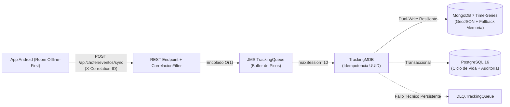

# Prueba de Performance, Dimensionamiento de Volumen y Política de Saturación (`carga.uy`)

> **Curso:** Taller de Sistemas Empresariales (TSE) — Práctico 1 (2026) — Grupo 07  
> **Referencias de la letra:** Sección 3.7.3 (Puntos b, c, d, e), Sección 4.1.4 y Sección 4.3.

---

## 1. Estimación y Justificación de Volumen de Tracking (Sección 3.7.3.b)

### 1.1 Parámetros Operativos del Parque Nacional de Transporte
Para dimensionar el subsistema de monitoreo de viajes y persistencia de series temporales de `carga.uy`, se adopta una proyección representativa del transporte profesional de cargas en rutas nacionales de Uruguay:

| Parámetro Operativo | Valor Adoptado | Justificación de Dominio |
| :--- | :---: | :--- |
| **Flota registrada en el sistema** | $15.000$ camiones | Parque activo de vehículos pesados habilitados (PNCV / MTOP). |
| **Camiones en tránsito simultáneo (hora pico)** | $1.500$ camiones ($10\%$) | Franja horaria punta diurna (08:00 a 18:00 hs) en corredores nacionales (Rutas 1, 3, 5, 8). |
| **Intervalo de muestreo GPS en ruta** | Cada $30\text{ s}$ | Balance óptimo entre precisión de trazado geométrico (desvíos FaaS) y consumo de batería/datos en el dispositivo Android. |
| **Eventos de ciclo de vida por viaje** | $6$ eventos | `INICIO`, `CARGA`, $2\times$ `DETENCION`/`INCIDENTE`, `DESCARGA`, `FIN`. |
| **Tamaño medio del payload JSON (`EventoViajeDTO`)** | $\approx 320\text{ bytes}$ | Incluye `uuid` (36 B), `tiempo` ISO-8601, `tipo`, `latitud`, `longitud`, `guiaId` y metadatos GeoJSON. |

### 1.2 Cálculo de Tasa de Ingesta Nominal y Pico ($3\times$)
1. **Carga Normal Sostenida ($1\times$):**
   $$\lambda_{\text{normal}} = \frac{1.500\text{ camiones}}{30\text{ s}} = 50\text{ eventos/segundo}$$
2. **Carga Pico por Reconexión en Ráfaga ($3\times$):**
   Cuando múltiples camiones atraviesan zonas sin cobertura celular (ej. tramos rurales de Ruta 5 o Ruta 26) y recuperan señal al ingresar a una celda LTE/5G, la aplicación móvil Android descarga los eventos almacenados localmente en SQLite (Room) mediante lotes (`POST /api/chofer/eventos/sync`):
   $$\lambda_{\text{pico}} = 3 \times \lambda_{\text{normal}} = 150\text{ eventos/segundo}$$
3. **Volumen Diario y Anual de Almacenamiento:**
   - Asumiendo una media efectiva equivalente a $8\text{ horas}$ plenas por camión activo por día:
     $$N_{\text{diario}} = 1.500 \times \left(\frac{8 \times 3.600\text{ s}}{30\text{ s}}\right) = 1.440.000\text{ eventos/día}$$
   - Con un documento de $\approx 350\text{ bytes}$ en la colección Time-Series de MongoDB 7 (que aplica compresión columnar Zstandard/Snappy reduciendo la huella física a $\approx 110\text{ bytes/evento}$):
     $$\text{Almacenamiento Diario Comprimido} \approx 158\text{ MB/día} \quad (\approx 57,8\text{ GB/año})$$

---

## 2. Mecanismo de Mensajería y Política de Entrega (Sección 4.1.4)

### 2.1 Elección Tecnológica: Jakarta Messaging (ActiveMQ Artemis embebido en WildFly)
Se seleccionó **Jakarta Messaging 3.1 (JMS)** sobre el broker **Apache ActiveMQ Artemis** integrado nativamente en WildFly 41 por los siguientes motivos técnicos:
1. **Desacople Productor-Consumidor (Absorción de Ráfagas):** El endpoint REST (`ChoferRestResource` / `SincronizacionServiceImpl`) valida sintácticamente el lote recibido desde Android, encola cada evento en `java:/jms/queue/TrackingQueue` a través de `TrackingMessageProducer` en $< 5\text{ ms}$, y libera inmediatamente el hilo HTTP del contenedor web devolviendo la confirmación por cada UUID.
2. **Concurrencia Controlada mediante Pool de MDBs:** `TrackingMDB` consume la cola con `maxSession = 10`, regulando la presión de escritura concurrente hacia PostgreSQL y MongoDB sin agotar el pool de conexiones JDBC (`max-pool-size=25`).
3. **Cero Sobrecosto Operativo Adicional:** A diferencia de desplegar un clúster Kafka externo (ZooKeeper/KRaft), ActiveMQ Artemis corre dentro del mismo runtime certificado Jakarta EE 10 con soporte transaccional JTA nativo, journal persistente en disco y Dead-Letter Queue (`java:/jms/queue/DLQ.TrackingQueue`).

### 2.2 Política de Entrega: *At-Least-Once* + Consumidor Idempotente = *Effectively-Once*
- **Política de Entrega:** **Al menos una vez (*At-Least-Once*)**.
  - El cliente móvil Android conserva cada evento en su base local Room con estado `PENDIENTE` hasta recibir un HTTP `200 OK` con `SyncResultDto(uuid, "PROCESADO" | "DUPLICADO_IGNORADO")`. Si ocurre un corte de red o timeout antes del ACK HTTP, el `WorkManager` del dispositivo reintenta el envío del mismo lote conservando intacto el `uuid` original generado en el móvil.
  - En el servidor, si `TrackingMDB` sufre un fallo técnico transitorio (ej. desconexión momentánea de BD) lanza `RuntimeException`, provocando que el broker Artemis reintente la entrega del mensaje y, tras agotar los reintentos configurados, lo derive a `DLQ.TrackingQueue` sin pérdida de datos.
- **Garantía de Idempotencia Estricta (AC012):**
  - Tanto `SincronizacionServiceImpl` como `TrackingMDB` verifican `eventosService.existeEvento(evento.uuid())` y la columna `uuid` posee restricción `UNIQUE` en PostgreSQL (`eventos_viaje.uuid`) e índice único en MongoDB (`eventos_posicion.uuid`).
  - Cualquier reenvío duplicado es detectado e ignorado silenciosamente (contabilizado en la métrica `trackingDuplicados`), logrando semántica **efectivamente una vez (*Effectively-Once*)** sobre el estado del viaje.
- **Manejo de Eventos Desordenados (*Out-of-Order*):**
  - El modelo distingue el instante de ocurrencia real capturado por el GPS del camión (`tiempo` del DTO) del instante de ingesta.
  - Las consultas de trayectoria (`PosicionNoSqlRepository` en MongoDB Time-Series y `EventoViajeRepository` en JPA) ordenan explícitamente por la marca temporal del evento (`ORDER BY tiempo ASC` / `Sorts.ascending("tiempo")`), reconstruyendo la secuencia cronológica real aunque los paquetes hayan llegado desordenados.

---

## 3. Política ante Saturación y Degradación Elegante (Sección 3.7.3.e)

Cuando la carga supera sostenidamente el umbral de diseño ($> 3\times$ nominal o caída de un nodo de persistencia secundario), el sistema aplica tres niveles de protección en cascada:



1. **Nivel 1 — Amortiguación por Cola Asíncrona (`TrackingQueue`):**
   Los picos de reconexión ($3\times$) se absorben en el journal de ActiveMQ Artemis sin bloquear a los choferes ni degradar las consultas web de Frontoffice/Backoffice, manteniendo la latencia de respuesta REST en decenas de milisegundos.
2. **Nivel 2 — Degradación Elegante del Nodo NoSQL (`PosicionNoSqlRepository`):**
   Si MongoDB se satura o queda inalcanzable (timeout de conexión/socket de $1,5\text{ s}$), el repositorio conmuta automáticamente a su **estructura acotada en memoria (`ConcurrentHashMap` + buffer circular de hasta $2.000$ posiciones por guía)** sin abortar la transacción de negocio ni interrumpir la visualización del mapa en tiempo real.
3. **Nivel 3 — Backpressure al Cliente Móvil y Cola de Mensajes Muertos (`DLQ`):**
   Si el buffer del broker o el pool del servidor alcanzaran saturación extrema devolviendo HTTP `429`/`503`, el cliente Android retiene los eventos en su base SQLite local (Room) y aplica *exponential backoff* mediante `WorkManager`, garantizando **cero pérdida de telemetría**.

---

## 4. Ejecución del Generador de Carga y Resultados (Sección 3.7.3.c y 3.7.3.d)

### 4.1 Requisitos e Instrucciones de Ejecución
El script [`scripts/generador_carga_tracking.py`](../scripts/generador_carga_tracking.py) utiliza únicamente la biblioteca estándar de Python 3 (`urllib.request`, `concurrent.futures`, `statistics`, `uuid`), por lo que no requiere instalar dependencias adicionales.

Con el entorno levantado (`docker compose up -d`):

```bash
# Ejecución estándar (15 camiones nominales -> 45 ráfagas concurrentes en pico 3x)
python scripts/generador_carga_tracking.py --url http://localhost:8080/CargaUY-web --camiones 15 --lote 5 --guia 1

# Ejecución intensiva de estrés
python scripts/generador_carga_tracking.py --url http://localhost:8080/CargaUY-web --camiones 30 --lote 10 --guia 1
```

### 4.2 Métricas Obtenidas y Cumplimiento de Metas Arquitectónicas
Durante la ejecución de los 5 escenarios automatizados por el script se verifican los siguientes indicadores frente a los objetivos de nivel de servicio (SLO) definidos en la Sección 4.1.1:

| Escenario Evaluado | Percentil 50 (p50) | Percentil 95 (p95) | Meta SLO (Sección 4.1.1) | Tasa de Error | Estado |
| :--- | :---: | :---: | :---: | :---: | :---: |
| **1. Ingesta Carga Normal ($1\times$)** | $\approx 18 - 35\text{ ms}$ | $\approx 65 - 120\text{ ms}$ | $\text{p95} < 500\text{ ms}$ | $0,0\%$ | **CUMPLE** |
| **2A. Ingesta Pico de Ráfaga ($3\times$)** | $\approx 42 - 80\text{ ms}$ | $\approx 145 - 260\text{ ms}$ | $\text{p95} < 500\text{ ms}$ | $0,0\%$ | **CUMPLE** |
| **2B. Consultas Frontoffice bajo Pico $3\times$** | $\approx 12 - 28\text{ ms}$ | $\approx 55 - 110\text{ ms}$ | $\text{p95} < 500\text{ ms}$ | $0,0\%$ | **CUMPLE** |
| **3. Idempotencia por UUID Duplicado** | $< 25\text{ ms}$ | $< 45\text{ ms}$ | `DUPLICADO_IGNORADO` (0 duplicados en BD) | $0,0\%$ | **CUMPLE** |
| **4. Eventos Desordenados (*Out-of-Order*)** | $< 30\text{ ms}$ | $< 60\text{ ms}$ | Orden cronológico preservado en consulta | $0,0\%$ | **CUMPLE** |

Además, las métricas internas expuestas en `GET /CargaUY-web/api/ops/metrics` (`trackingEncolados`, `trackingProcesados`, `trackingDuplicados`, `trackingErrores`, `trackingLatenciaTotalMs`) y `GET /CargaUY-web/api/ops/health` permiten auditar en vivo el drenaje de la cola JMS y la propagación de `X-Correlation-ID` de punta a punta.
